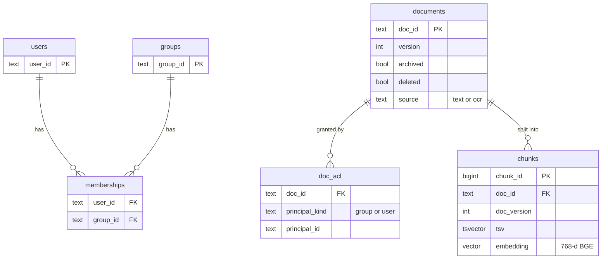
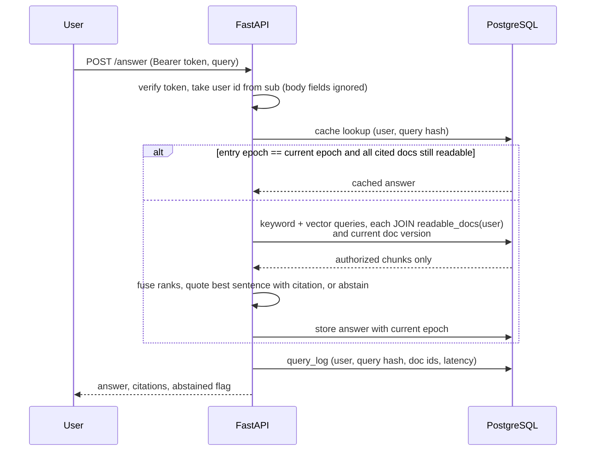

# 01 — Architecture

## Layers

```
┌────────────────────────────────────────────────────────────────────────┐
│ Surfaces    FastAPI /search /answer /citations/{id} /docs/{id}/preview │  search/api.py
├────────────────────────────────────────────────────────────────────────┤
│ Identity    bearer token -> verify HS256 -> user = sub; body ignored   │  identity/tokens.py
├────────────────────────────────────────────────────────────────────────┤
│ Answering   cache check (epoch + re-authorize) -> extractive | LLM     │  answer/   <- LLM only here
├────────────────────────────────────────────────────────────────────────┤
│ Retrieval   keyword (FTS) | vector (BGE, exact) | hybrid (RRF k=60)    │  search/retrieve.py
├────────────────────────────────────────────────────────────────────────┤
│ Authz       readable_docs(user) + current doc version, in the SQL      │  search/db.py   <- no LLM
├────────────────────────────────────────────────────────────────────────┤
│ Store       PostgreSQL 16 + pgvector: documents, doc_acl,              │
│             memberships, chunks, epoch, answer_cache, query_log        │
├────────────────────────────────────────────────────────────────────────┤
│ Write path  ingest (OCR, chunk, embed), update, delete,                │  search/ingest.py
│             grant/revoke, membership; every change bumps epoch         │
└────────────────────────────────────────────────────────────────────────┘
  Outside the request path: identity/oracle.py (plain-Python ground truth for tests and eval)
```

The rules that make this design worth writing down:

**Rule 1: authorization is a JOIN, not a filter.** Every retrieval query contains
`JOIN readable_docs(%(user)s) r ON r.doc_id = c.doc_id` (`search/retrieve.py`, `AUTHORIZED`).
Cache hits, citation links and previews call `can_read`, which queries the same function. Ranking, fusion and
the answerer never see an unauthorized chunk. That is why nothing can leak through result counts,
why a narrow-access user still gets a full top-k, and why the LLM's behaviour isn't part of the
access-control boundary ([04](04-grounded-answers.md)).

**Rule 2: permissions live in one place and are read at query time.** ACLs and memberships are
source tables, never copied into chunk rows or the cache. A change is visible to the next SQL
statement that runs after it commits. Cached answers are guarded by the epoch *and* by
re-authorizing every cited document on each hit ([03](03-freshness-and-revocation.md)).

**Rule 3: the system is graded by something it doesn't share code with.** `identity/oracle.py`
recomputes `can_read` from the fixture JSON in plain Python. The evaluation and tests check SQL
results against it, so a bug in `readable_docs()` shows up as a disagreement instead of agreeing
with itself ([02](02-authorization.md)).

## Data model (PostgreSQL)



Plus `epoch` (a single counter bumped by every permission or content change), `answer_cache`
(user, query hash, epoch, response, cited doc ids) and `query_log` (metadata only).

## Request path



The "quote best sentence" step is the extractive answerer. With `ANSWER_GENERATOR=llm` the same
step sends the top 5 authorized passages to the model and maps its passage-number citations back
to chunks ([04](04-grounded-answers.md)). The generator and prompt version are part of the cache
key, so switching generators never serves the other one's answer (`answer/service.py`).

## Decisions

| Decision | Alternative | Why |
| --- | --- | --- |
| Authorize inside the retrieval SQL | Retrieve a global top-k, then filter | Post-filtering leaks via counts and timing and starves results for users with narrow access |
| Read ACLs at query time | Copy ACLs into the index | Copies go stale; revocation would wait for re-indexing |
| One epoch counter for cache validity, plus per-hit re-authorization | Per-document cache invalidation | Simple and conservative; the cache is a latency optimisation, not a place where permissions live |
| Exact vector scan over authorized chunks | HNSW with filtering | pgvector 0.6 filtered ANN can return fewer than k rows **[verify]** against the pgvector 0.6 docs; exact is fast at this size |
| 404 for unauthorized citation/preview | 403 | Doesn't confirm that a document exists |
| Extractive answers first | LLM-written answers | Measures retrieval and authorization independently of a model; the LLM plugs into the same interface |
| Independent Python oracle for tests | Test against the SQL itself | A bug in `readable_docs()` can't hide itself |
| Token carries only `sub` and expiry | Roles or groups in the token | Groups are read from `memberships` per request, so a token can't carry stale or forged roles (`identity/tokens.py`) |
| Chunks carry `doc_version`; retrieval joins on the current version | Trust that replacement always succeeded | A chunk left behind by any failure never matches, so stale index data fails closed |
| Query log stores a SHA-256 of the query and doc ids | Log the query text | Query text can itself be sensitive; the log is for audit and latency, not replay |
| Unauthorized and nonexistent look identical (404, same body) | Distinct errors | A probing client learns nothing from the status code |

## Ingestion

1. Load principals and documents, then grants.
2. Scanned documents exist only as page images: OCR them (RapidOCR, ONNX Runtime) and reassemble paragraphs from line positions.
3. Chunk one paragraph per chunk, prefixed with the title.
4. Embed passages with BGE-base. Queries get BGE's retrieval prefix.
5. Updates write a new version and replace chunks in one transaction. Deletes mark the document and drop its chunks. Both bump the epoch.

OCR is the only step that changes what text exists. The ground truth for scanned pages
(`scan_truth.json`) is used by the oracle for leak checks, never by ingestion, so an OCR error can
lower recall but can't make the oracle think a value is readable when it isn't.

## Components

| Component | File | Owns | Talks to |
|---|---|---|---|
| Corpus generator | `corpus/generate.py` | Seeded documents, ACLs, users, questions, scanned-page images | writes `.run/corpus/*.json`, `scans/*.png` |
| Token issuer/verifier | `identity/tokens.py` | HS256 secret in `$SEARCH_RUN_DIR/token_secret` (mode 600, generated on first use) | API |
| Oracle | `identity/oracle.py` | `can_read`, `readable`, `forbidden_values` from fixture JSON | eval, tests (never the API) |
| Database lifecycle and schema | `search/db.py` | `up`/`down` of a user-space Postgres, schema, `readable_docs()`, `bump_epoch` | everything that reads or writes state |
| Ingestion and write path | `search/ingest.py` | OCR, chunking, embedding, `update_document`, `delete_document`, `set_acl`, `set_membership` | db, embed |
| Embeddings | `search/embed.py` | BGE-base-en-v1.5, CLS pooling, L2-normalised, query prefix | ingest, retrieve |
| Retrieval | `search/retrieve.py` | `keyword`, `vector`, `hybrid`, `can_read` | db, embed |
| Answer service | `answer/service.py` | Cache rules, generator choice | retrieve, extractive, llm |
| Extractive answerer | `answer/extractive.py` | Sentence/table-row selection, threshold, `INJECTION` pattern | — |
| LLM answerer | `answer/llm.py` | Prompt v2, JSON schema, citation mapping, error → abstention | project 01 gateway (`AGENT_LLM_URL`) |
| API | `search/api.py` | Endpoints, `caller()`, metadata-only logging | identity, retrieve, answer |
| Evaluation | `eval/run.py`, `eval/run_llm.py`, `eval/revocation.py`, `eval/llm_injection.py` | Scoring against the oracle, writing `results/` | everything above |

## State

| Table | Written by | Read by | Invalidated how |
|---|---|---|---|
| `users`, `groups`, `memberships` | ingest, `set_membership` | `readable_docs()`, `caller()` | Read live; membership change bumps epoch |
| `documents` | ingest, `update_document`, `delete_document` | retrieval joins, `readable_docs()` | `version` increments; `deleted` excludes it from `readable_docs()` |
| `doc_acl` | ingest, `set_acl` | `readable_docs()` | Read live; change bumps epoch |
| `chunks` | `_write_chunks` (delete-then-insert in the same transaction) | retrieval, citations, previews | Must match `documents.version` to be served |
| `epoch` | `bump_epoch` (same transaction as the change) | answer service | Monotonic counter |
| `answer_cache` | answer service | answer service | Served only if entry epoch = current epoch and every cited doc passes `can_read`. Stale rows stay in the table, unservable ([03](03-freshness-and-revocation.md)) |
| `query_log` | API | nobody in code | Append-only |

## Repository layout

```text
corpus/generate.py        synthetic company, ACLs, questions, scanned-page rendering (seed 7)
identity/tokens.py        issue / verify signed tokens
identity/oracle.py        independent authorization oracle (no SQL)
search/db.py              Postgres lifecycle, schema, readable_docs(), epoch
search/ingest.py          ingestion + update / delete / grant / revoke / membership
search/embed.py           BGE-base embeddings
search/retrieve.py        keyword, vector, hybrid retrieval, can_read
search/api.py             FastAPI app
answer/extractive.py      extractive cite-or-abstain baseline
answer/llm.py             LLM answerer (schema-constrained, prompt v2)
answer/service.py         retrieval -> generator -> permission-safe cache
eval/run.py               retrieval, answer and leak evaluation over every (question, user)
eval/run_llm.py           LLM vs extractive on the same hits, raw calls to results/raw/
eval/revocation.py        timed revocation scenarios
eval/llm_injection.py     planted-instruction analysis from recorded LLM runs
tests/                    8 integration tests (own Postgres on port 20433) + 7 unit tests
scripts/setup_postgres.sh user-space PostgreSQL 16 + pgvector 0.6.0 into .tools/
results/raw/              LLM call records (JSONL)
results/summary/          eval.json, revocation.json, llm_answers_*.json, llm_injection.json
env/ENVIRONMENT.md        host, Python, pinned packages, database and model versions
```

The layout is flatter than the one in PLAN.md § Target layout (no separate `ingestion/`, `cache/`
or `corpus/acl/`). [09](09-implementation-notes.md) § 1 explains why.
