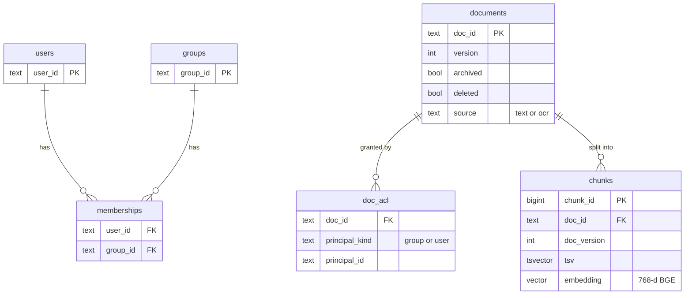
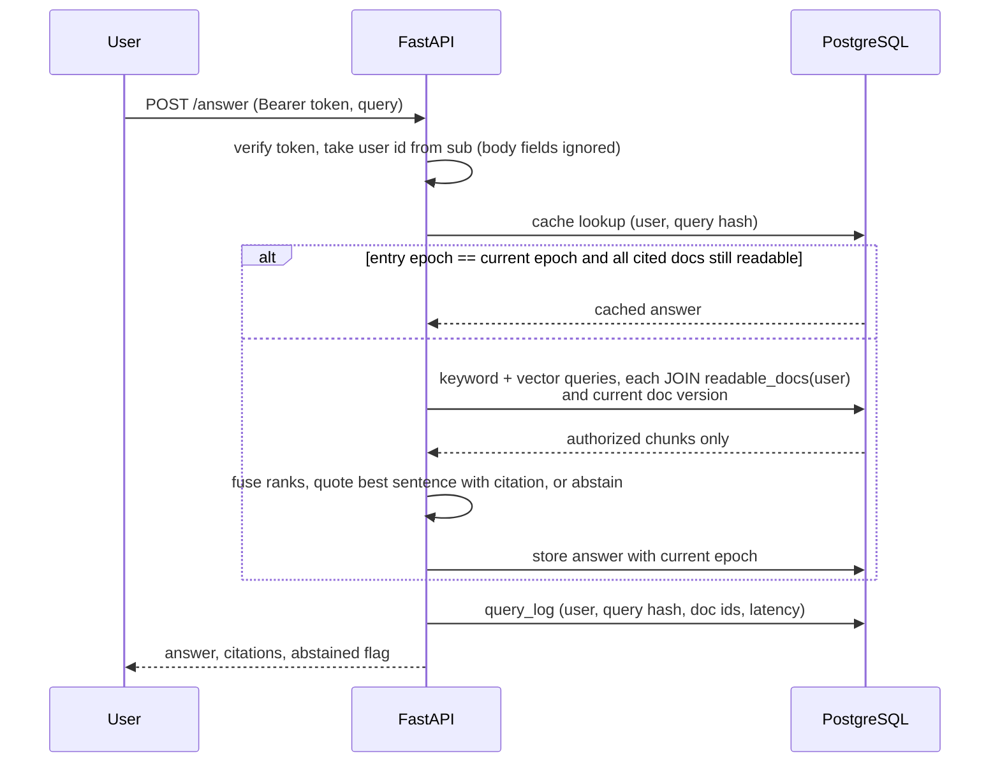

# Architecture

## Data model (PostgreSQL)

Plus `epoch` (a single counter bumped by every permission or content change), `answer_cache`
(user, query hash, epoch, response, cited doc ids) and `query_log` (metadata only).

## Request path

## Decisions

| Decision | Alternative | Why |
| --- | --- | --- |
| Authorize inside the retrieval SQL | Retrieve a global top-k, then filter | Post-filtering leaks via counts and timing and starves results for users with narrow access |
| Read ACLs at query time | Copy ACLs into the index | Copies go stale; revocation would wait for re-indexing |
| One epoch counter for cache validity, plus per-hit re-authorization | Per-document cache invalidation | Simple and conservative; the cache is a latency optimisation, not a place where permissions live |
| Exact vector scan over authorized chunks | HNSW with filtering | pgvector 0.6 filtered ANN can return fewer than k rows; exact is fast at this size |
| 404 for unauthorized citation/preview | 403 | Doesn't confirm that a document exists |
| Extractive answers first | LLM-written answers | Measures retrieval and authorization independently of a model; the LLM plugs into the same interface |
| Independent Python oracle for tests | Test against the SQL itself | A bug in `readable_docs()` can't hide itself |

## Ingestion

1. Load principals and documents, then grants.
2. Scanned documents exist only as page images: OCR them (RapidOCR, ONNX Runtime) and reassemble paragraphs from line positions.
3. Chunk one paragraph per chunk, prefixed with the title.
4. Embed passages with BGE-base. Queries get BGE's retrieval prefix.
5. Updates write a new version and replace chunks in one transaction. Deletes mark the document and drop its chunks. Both bump the epoch.
